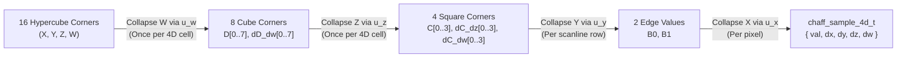

# 4D Analytical Spatiotemporal Noise & Wind-Coupled Volumetric Clouds

**Document Type**: Canonical Architecture Specification  
**Status**: Authoritative Reference  
**Scope**: `libchaff` (`external/libchaff`), NeverDark Seven 3D WebGL2 Renderer (`mods/nd/ux/nd_seven_gl.h`, `mods/nd/ux/nd_seven_gl.c`, `mods/nd/ux/nd_seven.c`)  
**Related Specifications**: [`docs/MULTI_SCALE_NOISE_AND_GPU_ARCHITECTURE.md`](MULTI_SCALE_NOISE_AND_GPU_ARCHITECTURE.md), [`docs/RECUR_NOISE.md`](RECUR_NOISE.md), [`docs/25D.md`](25D.md), [`docs/WATER_REQUIREMENTS.md`](WATER_REQUIREMENTS.md)

---

## 1. Executive Summary & Architectural Goals

This document specifies the mathematical and systems architecture for **4D analytical spatiotemporal noise** in `libchaff` (`<ttypt/noise.h>`, `<ttypt/chaff.h>`, `<ttypt/chaff_glsl.h>`) and its integration into NeverDark Seven's **wind-coupled 4D volumetric cloud, ground/water cloud shadow, and water cloud reflection pipeline** (`mods/nd/ux/nd_seven_gl.c`).

### Core Architectural Invariants
1. **Pure-Integer C99 Determinism in `libchaff`**:
   `chaff_sample_4d`, `chaff_sample_grad_4d`, `chaff_fill_slice_4d`, and `dim == 4` support in `chaff_fill` / `chaff_fill_lod` operate strictly in pure integer arithmetic (`int16_t` modular coordinates, `int64_t` multiply-then-shift fixed-point accumulators, zero floating-point instructions).
2. **Dimensional Reduction for Bulk 2D Slice Stepping (`16 -> 8 -> 4`)**:
   Evaluating a 4D hypercube $(X, Y, Z, W)$ naively at every pixel requires 16 corner hashes and 15 linear interpolations (7 across $W$, 4 across $Z$, 2 across $Y$, 1 across $X$). In `chaff_fill_slice_4d`, when stepping across a 2D horizontal $(X, Y)$ slice at fixed altitude $z$ and time $w$, the $W$ axis ($16 \to 8$) and $Z$ axis ($8 \to 4$) are pre-collapsed **once per 4D cell boundary**, reducing the inner pixel loop to a 4-corner 2D bilinear evaluation that is **100% bit-exact** with point-by-point `chaff_sample_grad_4d`.
3. **Bit-Exact 8-Byte `XXH32` 4D Lattice Hashing Across CPU & WebGL2**:
   A 4D coordinate vector `int16_t p[4] = { x, y, z, w }` occupies exactly 8 bytes, executing two 32-bit `XXH32_round` lanes (`v1 = (y & 0xFFFF) | (x << 16)` and `v2 = (z & 0xFFFF) | (w << 16)`) before the final `XXH32` avalanche. Both `<ttypt/chaff_glsl.h>` (`chaff_hash4`) and `mods/nd/ux/nd_seven_gl.c` replicate this exact 8-byte `XXH32` pipeline in GLSL ES 3.0.
4. **Unified Wind-Coupled Atmospheric Dynamics**:
   Planetary clouds in `nd_seven_gl.c` are driven by the exact same multi-octave moving recursive wind field (`eval_recursive_wind`) that drives ocean gravity waves and capillary cat's-paws, extended with **geostrophic altitude wind-shear** and **4D internal convective boiling** along the $W$ axis.

---

## 2. 4D Hypercube Dimensional Reduction & Analytical Derivatives (`libchaff`)

### 2.1 4D Lattice Coordinate Decomposition

For a 4D coordinate vector $\mathbf{p} = (x, y, z, w) \in \mathbb{Z}_2^{16}$ at octave scale $2^s$ (`shift = s`), each coordinate decomposes into a lattice cell origin and a fractional offset:

$$i_k = p_k \ \& \ \sim(2^s - 1), \qquad f_k = p_k \ \& \ (2^s - 1), \qquad t_k = \frac{f_k \ll 16}{2^s} \in [0, 65536]$$

All cell corner advancements use `int16_t` modular addition `(int16_t)((uint16_t)i_k + (uint16_t)step_px)`, preserving seamless cyclic wrap across the `32767 -> -32768` boundary.

### 2.2 Cubic & Quintic Hermite Fade & Analytical Derivative Polynomials

In Q16 fixed-point ($t \in [0, 65536]$):
- **Cubic Hermite ($C^1$, `NOISE_FADE3`)**:
  $$u_3(t) = t^2(3 - 2t), \qquad u_3'(t) = 6t(1 - t)$$
- **Quintic Hermite ($C^2$, `NOISE_FADE5`)**:
  $$u_5(t) = t^3(6t^2 - 15t + 10), \qquad u_5'(t) = 30t^2(t - 1)^2$$

### 2.3 Hierarchical 4D Hypercube Collapse ($16 \to 8 \to 4 \to 2 \to 1$)

Let $V_{a,b,c,d} \in [0, 255]$ denote the 16 corner hashes of the 4D hypercube at $(i_x + a\Delta, i_y + b\Delta, i_z + c\Delta, i_w + d\Delta)$ for $a,b,c,d \in \{0, 1\}$, scaled to Q16 (`<< 16`):

1. **Collapse $W$ ($16 \to 8$ corners)**:
   For each 3D cube index $m = a + 2b + 4c \in \{0 \dots 7\}$:
   $$D_m = V_{a,b,c,0} + \bigl((V_{a,b,c,1} - V_{a,b,c,0}) \cdot u_w \gg 16\bigr), \qquad \Delta_w D_m = V_{a,b,c,1} - V_{a,b,c,0}$$

2. **Collapse $Z$ ($8 \to 4$ corners)**:
   For each 2D square index $n = a + 2b \in \{0 \dots 3\}$:
   $$C_n = D_n + \bigl((D_{n+4} - D_n) \cdot u_z \gg 16\bigr), \qquad \Delta_z C_n = D_{n+4} - D_n$$
   $$\Delta_w C_n = \Delta_w D_n + \bigl((\Delta_w D_{n+4} - \Delta_w D_n) \cdot u_z \gg 16\bigr)$$

3. **Collapse $Y$ ($4 \to 2$ corners) and $X$ ($2 \to 1$ value)**:
   $$B_0 = C_0 + \bigl((C_2 - C_0) \cdot u_y \gg 16\bigr), \qquad B_1 = C_1 + \bigl((C_3 - C_1) \cdot u_y \gg 16\bigr)$$
   $$F(x,y,z,w) = B_0 + \bigl((B_1 - B_0) \cdot u_x \gg 16\bigr)$$

4. **Analytical 4D Partial Derivatives (`dx`, `dy`, `dz`, `dw`)**:
   $$\frac{\partial F}{\partial x} = \frac{((B_1 - B_0) \cdot u_x' \gg 16)}{2^s}, \qquad \frac{\partial F}{\partial y} = \frac{(\Delta_y(u_x) \cdot u_y' \gg 16)}{2^s}$$
   $$\frac{\partial F}{\partial z} = \frac{(\Delta_z(u_x, u_y) \cdot u_z' \gg 16)}{2^s}, \qquad \frac{\partial F}{\partial w} = \frac{(\Delta_w(u_x, u_y, u_z) \cdot u_w' \gg 16)}{2^s}$$

### 2.4 Public C & GLSL API Summary

| Header | Symbol | Purpose |
| :--- | :--- | :--- |
| `<ttypt/noise.h>` | `noise_sample_4d(pos, shift, seed, flags)` | Scalar 4D noise evaluation at `int16_t pos[4]` |
| `<ttypt/noise.h>` | `chaff_sample_4d(field, pos)` | Multi-octave 4D recursive field evaluation |
| `<ttypt/chaff.h>` | `chaff_sample_4d_t` | Struct `{ int16_t val, dx, dy, dz, dw }` (Q8.8 derivatives) |
| `<ttypt/chaff.h>` | `chaff_sample_grad_4d(pos, shift, seed, flags)` | Single-pass 4D value + analytical 4D partial derivatives |
| `<ttypt/chaff.h>` | `chaff_fill_slice_4d(...)` | Bulk 2D horizontal slice stepper at fixed `(z, w)` with $16 \to 8 \to 4$ pre-collapse |
| `<ttypt/chaff_glsl.h>` | `chaff_hash4(ivec4 p, uint seed)` | Bit-exact 8-byte `XXH32` 4D lattice corner hash in GLSL ES 3.0 |
| `<ttypt/chaff_glsl.h>` | `chaff_sample_4d` / `chaff_sample_grad_4d` | GLSL ES 3.0 4D noise and `vec4` analytical spatial+temporal gradient |

---

### 3. Observer-Gated ("Quantum") 8-Octave 4D Volumetric Cloud Architecture in NeverDark Seven

### 3.1 True 4D Isotropic Unit-Gradient Dot-Product Noise (`chaff_grad4`)

Scalar value noise in 4D exhibits axis-aligned hypercubic grid artifacts when domain-warped or thresholded at high contrast. To guarantee 100% smooth, isotropic cloud contours with zero lattice boxiness or pixelation at any zoom level, `nd_seven_gl.c` (`s_fs_terrain`, `s_fs_water`, `s_fs_billboard`, `s_vs_cloud`, `s_fs_cloud`, and CPU reference `gl_chaff_grad_noise4d`) unpacks 4D unit gradient vectors from the 32-bit `chaff_hash4` avalanche at all 16 hypercube corners:

$$\mathbf{g}(\mathbf{c}) = \text{normalize}\!\left(\text{float}\bigl((h \gg \{0,8,16,24\}) \ \& \ \text{0xFF}\bigr) - 128.0\right)$$

and interpolates the 16 directional dot products $v_k = \mathbf{g}_k \cdot (\mathbf{f}_p - \mathbf{o}_k)$ using quintic $C^2$ Hermite fade polynomials $u(t) = t^3(6t^2 - 15t + 10)$. Furthermore, both `s_fs_water` and `s_fs_cloud` sample `uSubstrateTex` through a shared quintic $C^2$ sub-texel filter (`sampleSubstrateSmooth(vUV)`), and `nd_seven_gl_flush_clouds` selects adaptive mesh subdivision (`select_grid_buffers(chk->level, ...)`) per chunk so neither substrate humidity nor cloud geometry ever exhibits bilinear texel or polygon faceting.

### 3.2 Scale-Invariant Planetary Synoptic Coverage & Horizon Zero Dawn (*Nubis*) Billow Erosion

`eval_zoom_cloud_density(vec3 worldPos, float anim_time, float humidity, float dist, float fw)` (and its pure-C counterpart `nd_seven_gl_eval_zoom_cloud_density`) evaluates an **8-octave rotated and phase-curled 4D fractal cascade** across the vertical altitude slab $z \in [92.0, 232.0]$:

- **Stage 1 — Scale-Invariant Planetary Synoptic Weather Systems & Clear-Sky Corridors (Octaves 0–2)**:
  - **Octave 0 (`0.000018`, $\lambda \approx 55{,}500$)**, **Octave 1 (`0.000075`, $\lambda \approx 13{,}300$)**, and **Octave 2 (`0.000280`, $\lambda \approx 3{,}570$)** are evaluated **un-attenuated at all zoom distances** (`dFar = 12000000.0`) with dimensionless phase-space curl (`phaseCurl = rot * phaseCurl * 0.55 + vec2(n - 0.5, 0.5 - n) * 0.42`) and `mat2(0.8, -0.6, 0.6, 0.8)` octave rotation.
  - **Scale-Invariant Synoptic & Mesoscale Gating**:
    $$\text{synFront} = 0.46\,\text{oct}_0 + 0.54\,\text{oct}_1, \qquad \text{synGate} = \text{smoothstep}(0.52 - 0.11 H, \; 0.72 - 0.07 H, \; \text{synFront})$$
    $$\text{macroCell} = \text{mix}\bigl(\text{oct}_2, \; 1 - |2\,\text{oct}_2 - 1|, \; 0.42\bigr), \qquad \text{macroCoverage} = \text{synGate} \cdot \text{smoothstep}(0.41 - 0.05 H, \; 0.74 - 0.04 H, \; \text{macroCell})$$
    Because Octaves 0–2 have constant weights across all camera distances, **~60–65% of the planet remains crystal-clear sky** (`macroCoverage <= 0.015`, triggering an immediate early return before any wind or fine-octave evaluation) and **~35–40% forms coherent synoptic frontal belts and cumulus decks** from orbital zoom `-25x` (`uCamDist > 1,000,000`) all the way down to ground level (`1x`).
  - **3D Vertical Cumulus & Anvil Envelope ($z \in [92, 232]$)**:
    Strong cloud cores tower up to $z_{\text{top}} = \text{mix}(132.0, 232.0, \text{coreStrength})$ while thin perimeter fringes stay low ($z \approx 132$), shaped by rounded base/crown vertical profiles $v_{\text{prof}}(h_{\text{local}}) = \text{smoothstep}(0.0, 0.15, h_{\text{local}}) \cdot \text{smoothstep}(1.0, 0.42, h_{\text{local}})$ and mapped into the base cloud envelope via `cloud_remap`:
    $$\text{baseCloud} = \text{clamp}\!\left(\text{cloud\_remap}\bigl(\text{macroCoverage} \cdot v_{\text{prof}}, \; 0.12(1 - 0.45\,\text{coreStrength}), \; 0.86, \; 0.0, \; 1.0\bigr), \; 0.0, \; 1.0\right)$$

- **Stage 2 — Horizon Zero Dawn (*Nubis*) 4D Billow Cauliflower Erosion (Octaves 3–7)**:
  - Evaluated **only inside a macro cloud** ($\text{baseCloud} > 0.002$) and **only when the observer is within $d_{\text{far},3} = 240{,}000$**:
    - **Octave 3 (`0.000950`, $\lambda \approx 1{,}050$, $d_{\text{far}} = 240\text{k}$)**: Large regional cumulus lobes.
    - **Octave 4 (`0.003100`, $\lambda \approx 322$, $d_{\text{far}} = 42\text{k}$)**: Individual cumulus towers.
    - **Octave 5 (`0.009800`, $\lambda \approx 102$, $d_{\text{far}} = 10\text{k}$)**: Cauliflower turrets.
    - **Octave 6 (`0.031000`, $\lambda \approx 32$, $d_{\text{far}} = 2.6\text{k}$)**: Perimeter billow curls.
    - **Octave 7 (`0.096000`, $\lambda \approx 10$, $d_{\text{far}} = 1.05\text{k}$)**: Close-up turbulent filaments and shadow wisps.
  - Coupled to `eval_recursive_wind(worldPos.xy, anim_time)` with geostrophic altitude wind-shear and 4D convective boiling (`wBoil = mod(anim_time * 0.072, 512.0)`).
  - Instead of additive FBM, each active fine octave forms a rounded billow lobe $\text{billow}_i = 1 - |2 n_i - 1|$ (`cauliflower = mix(billow, n, 0.28)`), and the normalized high-frequency billow FBM **erodes the outer shell** of `baseCloud`:
    $$\text{baseCloud} \leftarrow \text{clamp}\bigl(\text{cloud\_remap}(\text{baseCloud}, \; \text{erodeAmt}, \; 1.0, \; 0.0, \; 1.0), \; 0.0, \; 1.0\bigr)$$
    carving crisp, rounded cauliflower domes and silver-lined edges while keeping the deep interior core solid.

### 3.3 True 3D GPU Vertex Dome Relief & 3D Ray-Slab "Airplane Descent" Fly-Through

1. **True 3D GPU Vertex Dome Displacement (`s_vs_cloud`)**:
   - Rather than a flat shell at a single constant altitude, `s_vs_cloud` evaluates the synoptic/mesoscale macro dome (`eval_vertex_cloud_dome(worldXY, uAnimTime)`) per vertex and displaces the curved torus cloud mesh along the outward surface normal:
     $$\text{effWz} = 104.0 + 84.0 \cdot \text{macroDome} \in [104.0, 188.0]$$
     passing `vShellZ = effWz` to the fragment shader so towering cumulus domes exhibit genuine 3D geometric parallax as the camera orbits or tilts.
2. **Analytical 3D Ray-Slab Intersection & Natural Airplane-Descent Fly-Through (`s_fs_cloud`)**:
   - In `s_fs_cloud`, the fragment reconstructs the camera eye's exact local altitude `camAlt = vShellZ + dot(vViewDir, torusN)` and 3D view ray direction `(dxy, dz)` through the cloud slab $[z_{\text{base}}, z_{\text{top}}] = [92.0, 232.0]$:
     $$t_0 = \frac{z_{\text{base}} - \text{camAlt}}{dz}, \qquad t_1 = \frac{z_{\text{top}} - \text{camAlt}}{dz}, \qquad t_{\text{enter}} = \max\bigl(18.0\,\text{smoothstep}(260.0, 92.0, \text{camAlt}), \; \min(t_0, t_1)\bigr), \qquad t_{\text{exit}} = \min\bigl(t_{\text{max}}, \; \max(t_0, t_1)\bigr)$$
   - **Zero Fake Circular Hole (`apertureMask` Eliminated)**:
     - **Descending from Orbit (`uCamDist > 1,000,000 -> 500`)**: The camera looks down through the full 3D slab ($t_{\text{enter}} \to t_{\text{exit}}$), seeing 3D cauliflower domes rising toward the lens.
     - **Flying Through the Cloud Deck (`uCamDist ~ 500 -> 260`, `camAlt` inside `[92, 232]`)**: $t_{\text{enter}}$ is clamped right in front of the lens while $t_{\text{exit}}$ extends along the oblique view ray; clouds part naturally in 3D perspective around the descending camera like an airplane descending through a cumulus deck.
     - **Breaking Out Below the Cloud Base (`camAlt < 92.0` looking downward `dz <= 0.0`, and `uCamDist < 235.0`)**: Both $t_0$ and $t_1$ are negative (the overhead cloud slab is physically behind/above the camera lens!), so `camAlt < zBase && dz <= 0.0` (and `nd_seven_gl_flush_clouds` below `cur_dist < 235.0f`) cleanly exits with zero overdraw while overhead clouds continue to cast moving 4D fractal shadows onto the lamb (`s_fs_billboard`), terrain (`s_fs_terrain`), and water (`s_fs_water`, plus wave-tilted cloud reflections `reflCloudDens`).
3. **Observer-Adaptive 4-to-6 Step Jittered 3D Raymarch & Beer-Powder Multi-Scattering**:
   - Marches `numSteps` (`4` when `vDistance > 16000`, `5` when `vDistance > 3800`, `6` when close) jittered 3D points along the ray slab with early opacity termination (`(1.0 - trans) >= 0.98`) and clear-sky early exit (`s == 2 && trans > 0.999`).
   - At each active sample, probes solar optical depth $\tau_{\odot}$ and vertical crown gradient (`dSun1`, `dTop`) to form a 3D cloud normal `cloudGradN` and evaluates Horizon Zero Dawn Beer-Powder multi-scattering + Henyey-Greenstein forward/back silver-lining phase:
     $$E_{\text{light}}(\tau_{\odot}) = \Bigl(e^{-\tau_{\odot}}\bigl(0.44 + 0.96(1 - e^{-2.45\tau_{\odot}})\bigr) + 0.22\,e^{-0.35\tau_{\odot}}\Bigr) \cdot \Phi_{\text{HG}}(\cos\theta) \cdot \text{domeLambert}$$

---

## 4. Verification & Quality Gates

- **`external/libchaff/tests/test_chaff.c`**:
  - Test 14: Verifies `chaff_sample_grad_4d` value parity with `noise_sample_4d` and analytical gradient sign/bounds across all 4 axes (`dx`, `dy`, `dz`, `dw`) under both `NOISE_FADE3` and `NOISE_FADE5`.
  - Test 15: Verifies 100% bit-exact parity between `chaff_fill_slice_4d` and point-by-point `chaff_sample_grad_4d` across multi-cell boundaries and `int16_t` modular wrap limits (`32760 -> -32768`), plus `dim == 4` `chaff_fill` / `chaff_fill_lod` parity.
  - Test 16: Verifies 100% bit-exact parity between `chaff_glsl_ref_hash4` and `noise_r(va, seed, 0, 4)`, plus `chaff_glsl_ref_sample_grad_4d` analytical derivative accuracy against central finite differences.
- **`tests/unit/test_seven_render.c`**:
  - Validates all 4 WebGL2 shader programs (`terrain`, `water`, `billboard`, `cloud`) with `glslangValidator -l` (GLSL ES 3.00).
  - Verifies `chaff_grad4`, `cloud_remap`, `eval_vertex_cloud_dome`, `vShellZ`, `camAlt`, and `sampleSubstrateSmooth` shader contracts, `nd_seven_gl_eval_zoom_cloud_density` determinism, planetary clear-sky (~65%) vs. cloudy (~35%) synoptic distribution, towering cloud core vs. crown vertical profiles (`[92..232]`), observer-distance progressive octave gradient activation (`close > mid > far`), climate humidity sensitivity (`humid > arid * 1.25`), and 4D temporal derivative stability at $t = 100{,}000\text{ s}$ vs $t = 10\text{ s}$.

