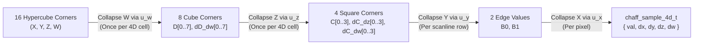

# 4D Analytical Spatiotemporal Noise & Wind-Coupled Volumetric Clouds

**Document Type**: Canonical Architecture Specification  
**Status**: Authoritative Reference  
**Scope**: `libchaff` (`external/libchaff`), NeverDark Seven 3D WebGL2 Renderer (`mods/nd/ux/nd_seven_gl.h`, `mods/nd/ux/nd_seven_gl.c`, `mods/nd/ux/nd_seven.c`)  
**Related Specifications**: [`docs/MULTI_SCALE_NOISE_AND_GPU_ARCHITECTURE.md`](MULTI_SCALE_NOISE_AND_GPU_ARCHITECTURE.md), [`docs/RECUR_NOISE.md`](RECUR_NOISE.md), [`docs/25D.md`](25D.md), [`docs/WATER_REQUIREMENTS.md`](WATER_REQUIREMENTS.md)

---

## 1. Executive Summary & Architectural Goals

This document specifies the mathematical and systems architecture for **4D analytical spatiotemporal noise** in `libchaff` (`<ttypt/noise.h>`, `<ttypt/chaff.h>`, `<ttypt/chaff_glsl.h>`) and its integration into NeverDark Seven's **wind-coupled 4D volumetric cloud, ground/water cloud shadow, and water cloud reflection pipeline** (`mods/nd/ux/nd_seven_gl.c`).

### Core Architectural Invariants
1. **Pure-Integer C99 Determinism in `libchaff`**:
   `chaff_sample_4d`, `chaff_sample_grad_4d`, `chaff_fill_slice_4d`, and `dim == 4` support in `chaff_fill` / `chaff_fill_lod` operate strictly in pure integer arithmetic (`int16_t` modular coordinates, `int64_t` multiply-then-shift fixed-point accumulators, zero floating-point instructions).
2. **Dimensional Reduction for Bulk 2D Slice Stepping (`16 -> 8 -> 4`)**:
   Evaluating a 4D hypercube $(X, Y, Z, W)$ naively at every pixel requires 16 corner hashes and 15 linear interpolations (7 across $W$, 4 across $Z$, 2 across $Y$, 1 across $X$). In `chaff_fill_slice_4d`, when stepping across a 2D horizontal $(X, Y)$ slice at fixed altitude $z$ and time $w$, the $W$ axis ($16 \to 8$) and $Z$ axis ($8 \to 4$) are pre-collapsed **once per 4D cell boundary**, reducing the inner pixel loop to a 4-corner 2D bilinear evaluation that is **100% bit-exact** with point-by-point `chaff_sample_grad_4d`.
3. **Bit-Exact 8-Byte `XXH32` 4D Lattice Hashing Across CPU & WebGL2**:
   A 4D coordinate vector `int16_t p[4] = { x, y, z, w }` occupies exactly 8 bytes, executing two 32-bit `XXH32_round` lanes (`v1 = (y & 0xFFFF) | (x << 16)` and `v2 = (z & 0xFFFF) | (w << 16)`) before the final `XXH32` avalanche. Both `<ttypt/chaff_glsl.h>` (`chaff_hash4`) and `mods/nd/ux/nd_seven_gl.c` replicate this exact 8-byte `XXH32` pipeline in GLSL ES 3.0.
4. **Unified Wind-Coupled Atmospheric Dynamics**:
   Planetary clouds in `nd_seven_gl.c` are driven by the exact same multi-octave moving recursive wind field (`eval_recursive_wind`) that drives ocean gravity waves and capillary cat's-paws, extended with **geostrophic altitude wind-shear** and **4D internal convective boiling** along the $W$ axis.

---

## 2. 4D Hypercube Dimensional Reduction & Analytical Derivatives (`libchaff`)

### 2.1 4D Lattice Coordinate Decomposition

For a 4D coordinate vector $\mathbf{p} = (x, y, z, w) \in \mathbb{Z}_2^{16}$ at octave scale $2^s$ (`shift = s`), each coordinate decomposes into a lattice cell origin and a fractional offset:

$$i_k = p_k \ \& \ \sim(2^s - 1), \qquad f_k = p_k \ \& \ (2^s - 1), \qquad t_k = \frac{f_k \ll 16}{2^s} \in [0, 65536]$$

All cell corner advancements use `int16_t` modular addition `(int16_t)((uint16_t)i_k + (uint16_t)step_px)`, preserving seamless cyclic wrap across the `32767 -> -32768` boundary.

### 2.2 Cubic & Quintic Hermite Fade & Analytical Derivative Polynomials

In Q16 fixed-point ($t \in [0, 65536]$):
- **Cubic Hermite ($C^1$, `NOISE_FADE3`)**:
  $$u_3(t) = t^2(3 - 2t), \qquad u_3'(t) = 6t(1 - t)$$
- **Quintic Hermite ($C^2$, `NOISE_FADE5`)**:
  $$u_5(t) = t^3(6t^2 - 15t + 10), \qquad u_5'(t) = 30t^2(t - 1)^2$$

### 2.3 Hierarchical 4D Hypercube Collapse ($16 \to 8 \to 4 \to 2 \to 1$)

Let $V_{a,b,c,d} \in [0, 255]$ denote the 16 corner hashes of the 4D hypercube at $(i_x + a\Delta, i_y + b\Delta, i_z + c\Delta, i_w + d\Delta)$ for $a,b,c,d \in \{0, 1\}$, scaled to Q16 (`<< 16`):

1. **Collapse $W$ ($16 \to 8$ corners)**:
   For each 3D cube index $m = a + 2b + 4c \in \{0 \dots 7\}$:
   $$D_m = V_{a,b,c,0} + \bigl((V_{a,b,c,1} - V_{a,b,c,0}) \cdot u_w \gg 16\bigr), \qquad \Delta_w D_m = V_{a,b,c,1} - V_{a,b,c,0}$$

2. **Collapse $Z$ ($8 \to 4$ corners)**:
   For each 2D square index $n = a + 2b \in \{0 \dots 3\}$:
   $$C_n = D_n + \bigl((D_{n+4} - D_n) \cdot u_z \gg 16\bigr), \qquad \Delta_z C_n = D_{n+4} - D_n$$
   $$\Delta_w C_n = \Delta_w D_n + \bigl((\Delta_w D_{n+4} - \Delta_w D_n) \cdot u_z \gg 16\bigr)$$

3. **Collapse $Y$ ($4 \to 2$ corners) and $X$ ($2 \to 1$ value)**:
   $$B_0 = C_0 + \bigl((C_2 - C_0) \cdot u_y \gg 16\bigr), \qquad B_1 = C_1 + \bigl((C_3 - C_1) \cdot u_y \gg 16\bigr)$$
   $$F(x,y,z,w) = B_0 + \bigl((B_1 - B_0) \cdot u_x \gg 16\bigr)$$

4. **Analytical 4D Partial Derivatives (`dx`, `dy`, `dz`, `dw`)**:
   $$\frac{\partial F}{\partial x} = \frac{((B_1 - B_0) \cdot u_x' \gg 16)}{2^s}, \qquad \frac{\partial F}{\partial y} = \frac{(\Delta_y(u_x) \cdot u_y' \gg 16)}{2^s}$$
   $$\frac{\partial F}{\partial z} = \frac{(\Delta_z(u_x, u_y) \cdot u_z' \gg 16)}{2^s}, \qquad \frac{\partial F}{\partial w} = \frac{(\Delta_w(u_x, u_y, u_z) \cdot u_w' \gg 16)}{2^s}$$

### 2.4 Public C & GLSL API Summary

| Header | Symbol | Purpose |
| :--- | :--- | :--- |
| `<ttypt/noise.h>` | `noise_sample_4d(pos, shift, seed, flags)` | Scalar 4D noise evaluation at `int16_t pos[4]` |
| `<ttypt/noise.h>` | `chaff_sample_4d(field, pos)` | Multi-octave 4D recursive field evaluation |
| `<ttypt/chaff.h>` | `chaff_sample_4d_t` | Struct `{ int16_t val, dx, dy, dz, dw }` (Q8.8 derivatives) |
| `<ttypt/chaff.h>` | `chaff_sample_grad_4d(pos, shift, seed, flags)` | Single-pass 4D value + analytical 4D partial derivatives |
| `<ttypt/chaff.h>` | `chaff_fill_slice_4d(...)` | Bulk 2D horizontal slice stepper at fixed `(z, w)` with $16 \to 8 \to 4$ pre-collapse |
| `<ttypt/chaff_glsl.h>` | `chaff_hash4(ivec4 p, uint seed)` | Bit-exact 8-byte `XXH32` 4D lattice corner hash in GLSL ES 3.0 |
| `<ttypt/chaff_glsl.h>` | `chaff_sample_4d` / `chaff_sample_grad_4d` | GLSL ES 3.0 4D noise and `vec4` analytical spatial+temporal gradient |

---

## 3. Wind-Coupled Multi-Layer 4D Fractal Cloud Architecture in NeverDark Seven

### 3.1 Multi-Active 4D Fractal Cascade & Perimeter Billow Erosion

In `mods/nd/ux/nd_seven_gl.c`, `eval_planetary_cloud_density(vec3 worldPos, float anim_time, float humidity)` evaluates a **5-octave rotated and domain-warped 4D fractal cascade** coupled to `eval_recursive_wind(worldPos.xy, anim_time)`:
- **Three Vertical Cloud Strata (`uCloudDeck`)**:
  - **Deck 0 — Low Cumulus / Stratocumulus ($z \in [88, 144]$)**: Dense cauliflower cumulus towers and broken stratocumulus bases.
  - **Deck 1 — Mid Altocumulus / Congestus ($z \in [168, 228]$)**: Mid-level dappled cloud banks with elevated wind speed and geostrophic directional veer.
  - **Deck 2 — High Cirrus / Anvil Wisps ($z \in [268, 320]$)**: High-altitude fibrous wisps sheared strongly by upper-tropospheric winds.
  Each deck samples an uncorrelated 4D $Z$-slice (`zSlice = deckIdx * 7.3 + hLocal * 2.4`) and spatial offset (`deckIdx * vec2(410.0, -290.0)`), producing genuine 3D vertical parallax and independent layer evolution across all zoom levels.
- **5-Octave 4D Spatiotemporal Cascade with Inter-Octave Rotation & Domain Warping**:
  1. **Synoptic Weather Fronts (`0.00048`, seed `0x434C4453`)**: Organizes planetary-scale cloud bands and clear-sky corridors when zoomed out toward the stratosphere.
  2. **Macro Cloud Clusters (`0.00185`, seed `0x434C4430`)**: Rotated by `mat2(0.8, -0.6, 0.6, 0.8)` and warped by synoptic gradients to form mesoscale cloud groups.
  3. **Mesoscale Cumulus Bodies (`0.00580`, seed `0x434C4431`)**: Blends smooth and billow-folded (`1.0 - abs(2.0 * nMeso - 1.0)`) lobes.
  4. **Billowing Cauliflower Turrets (`0.01650`, seed `0x434C4432`)**: High-contrast 4D billow ridges (`billow3`).
  5. **Fine Turbulent Wisps (`0.04400`, seed `0x434C4433`)**: High-frequency 4D curl/billow filaments (`billow4`, `nTurb`).
- **Fractal Perimeter Erosion (`fbmErode`)**:
  Instead of linearly averaging octaves (which blurs clouds into flat blobs), the macro/mesoscale envelope `macroShape` is **eroded at its perimeter** by the higher-frequency 4D billow cascade `fbmErode = 0.52*(1 - billow3) + 0.30*(1 - billow4) + 0.18*(1 - nTurb)`, weighted strongest along cloud edges and upper anvil tops (`erodeWeight = mix(0.38, 0.12, baseCov) + 0.08 * hLocal`).
- **Biome & Bathymetric Climate Humidity**: Coverage threshold $\tau_{\text{clim}} = \text{clamp}(0.49 - 0.19 \cdot H_{\text{bio}} + \text{deckBias}, 0.28, 0.62)$ couples cloud density to local substrate biome weights (`wTropical`, `wTemperate`, `wPolar`, `wVolcanic`) and water proximity.

### 3.2 Three-Pass Atmospheric Integration in the 3D Stage

1. **Pass 1 — Multi-Layer Projected Cloud Ground Shadows (`s_fs_terrain`)**:
   `eval_planetary_cloud_shadow` projects each terrain fragment along the Northwest directional sun vector $\mathbf{L}_{\text{sun}} = \text{normalize}(-0.577, -0.577, 0.816)$ to all three cloud strata ($z \in \{110, 192, 288\}$) with altitude-proportional lateral displacement (`dzLow`, `dzMid`, `dzHigh`), modulating direct solar diffuse and wet-shore/mineral specular glints while smoothly preserving shallow underwater seabed transmission.
2. **Pass 2 — Water Cloud Shadows & Multi-Layer Wave-Perturbed Cloud Reflections (`s_fs_water`)**:
   Modulates solar glitter (`specSun`) and wave slope hillshading by `sunTrans`, and traces the wave-normal reflection ray `waveRefl = reflect(-viewDir, waveNormal)` across both low ($z = 112$) and mid ($z = 192$) cloud strata to blend reflected sunlit clouds into `reflSkyCol`.
3. **Pass 3 — Multi-Shell Curved-Torus Volumetric Cloud Pass (`s_vs_cloud`, `s_fs_cloud`, `nd_seven_gl_flush_clouds`)**:
   - **Three Curved-Torus Altitude Shells**: `nd_seven_gl_flush_clouds` renders all three cloud decks (`[88..144]`, `[168..228]`, `[268..320]`) via `uCloudDeck` in back-to-front painter's order relative to camera altitude.
   - **Close-Up Diorama Aperture Parting**: When the camera zooms in close (`uCamDist < 1350.0`), a smooth radial aperture (`apertureMask`) parts clouds around the focal center (`length(vRelXY)`) so low-altitude clouds never obscure gameplay, while closing seamlessly into a multi-layer planetary cloudscape as the camera zooms out.
   - **5-Step Volumetric Ray-Slab Integration, Inter-Deck Self-Shadowing & Beer-Powder Silver-Lining**: Integrates optical depth across 5 normalized slab heights per deck (`slabF = {0.10, 0.26, 0.45, 0.66, 0.88}`), including **inter-deck shadow casting** (upper decks casting sun shadows onto lower decks) and Henyey-Greenstein + Beer-Powder silver-lining scattering:
     $$E_{\text{light}}(\tau_{\odot}) = \text{mix}\!\left(e^{-\tau_{\odot}}, \; e^{-\tau_{\odot}}\bigl(0.42 + 0.98(1 - e^{-2.35\tau_{\odot}})\bigr), \; 0.68\right) \cdot \Phi_{\text{HG}}(\cos\theta)$$

---

## 4. Verification & Quality Gates

- **`external/libchaff/tests/test_chaff.c`**:
  - Test 14: Verifies `chaff_sample_grad_4d` value parity with `noise_sample_4d` and analytical gradient sign/bounds across all 4 axes (`dx`, `dy`, `dz`, `dw`) under both `NOISE_FADE3` and `NOISE_FADE5`.
  - Test 15: Verifies 100% bit-exact parity between `chaff_fill_slice_4d` and point-by-point `chaff_sample_grad_4d` across multi-cell boundaries and `int16_t` modular wrap limits (`32760 -> -32768`), plus `dim == 4` `chaff_fill` / `chaff_fill_lod` parity.
  - Test 16: Verifies 100% bit-exact parity between `chaff_glsl_ref_hash4` and `noise_r(va, seed, 0, 4)`, plus `chaff_glsl_ref_sample_grad_4d` analytical derivative accuracy against central finite differences.
- **`tests/unit/test_seven_render.c`**:
  - Validates all 4 WebGL2 shader programs (`terrain`, `water`, `billboard`, `cloud`) with `glslangValidator -l` (GLSL ES 3.00).
  - Verifies `nd_seven_gl_eval_cloud_density` determinism across all 3 vertical cloud strata (`z = 108, 192, 288`), clear inter-deck gaps (`z = 84, 156, 248, 326`), climate humidity sensitivity (`humid > arid * 1.25`), and 4D temporal derivative stability at $t = 100{,}000\text{ s}$ vs $t = 10\text{ s}$.
