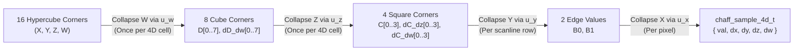

# 4D Analytical Spatiotemporal Noise & Wind-Coupled Volumetric Clouds

**Document Type**: Canonical Architecture Specification  
**Status**: Authoritative Reference  
**Scope**: `libchaff` (`external/libchaff`), NeverDark Seven 3D WebGL2 Renderer (`mods/nd/ux/nd_seven_gl.h`, `mods/nd/ux/nd_seven_gl.c`, `mods/nd/ux/nd_seven.c`)  
**Related Specifications**: [`docs/MULTI_SCALE_NOISE_AND_GPU_ARCHITECTURE.md`](MULTI_SCALE_NOISE_AND_GPU_ARCHITECTURE.md), [`docs/RECUR_NOISE.md`](RECUR_NOISE.md), [`docs/25D.md`](25D.md), [`docs/WATER_REQUIREMENTS.md`](WATER_REQUIREMENTS.md)

---

## 1. Executive Summary & Architectural Goals

This document specifies the mathematical and systems architecture for **4D analytical spatiotemporal noise** in `libchaff` (`<ttypt/noise.h>`, `<ttypt/chaff.h>`, `<ttypt/chaff_glsl.h>`) and its integration into NeverDark Seven's **wind-coupled $\text{4D} \to \text{3D} \to \text{2D}$ volumetric cloud, ground/water/lamb cloud shadow, and water cloud reflection pipeline** (`mods/nd/ux/nd_seven_gl.c`).

### Core Architectural Invariants
1. **Pure-Integer C99 Determinism in `libchaff`**:
   `chaff_sample_4d`, `chaff_sample_grad_4d`, `chaff_fill_slice_4d`, and `dim == 4` support in `chaff_fill` / `chaff_fill_lod` operate strictly in pure integer arithmetic (`int16_t` modular coordinates, `int64_t` multiply-then-shift fixed-point accumulators, zero floating-point instructions).
2. **Dimensional Reduction for Bulk 2D Slice Stepping (`16 -> 8 -> 4`)**:
   Evaluating a 4D hypercube $(X, Y, Z, W)$ naively at every pixel requires 16 corner hashes and 15 linear interpolations (7 across $W$, 4 across $Z$, 2 across $Y$, 1 across $X$). In `chaff_fill_slice_4d`, when stepping across a 2D horizontal $(X, Y)$ slice at fixed altitude $z$ and time $w$, the $W$ axis ($16 \to 8$) and $Z$ axis ($8 \to 4$) are pre-collapsed **once per 4D cell boundary**, reducing the inner pixel loop to a 4-corner 2D bilinear evaluation that is **100% bit-exact** with point-by-point `chaff_sample_grad_4d`.
3. **Bit-Exact 8-Byte `XXH32` 4D Lattice Hashing Across CPU & WebGL2**:
   A 4D coordinate vector `int16_t p[4] = { x, y, z, w }` occupies exactly 8 bytes, executing two 32-bit `XXH32_round` lanes (`v1 = (y & 0xFFFF) | (x << 16)` and `v2 = (z & 0xFFFF) | (w << 16)`) before the final `XXH32` avalanche. Both `<ttypt/chaff_glsl.h>` (`chaff_hash4`) and `mods/nd/ux/nd_seven_gl.c` replicate this exact 8-byte `XXH32` pipeline in GLSL ES 3.0.
4. **Evolved 5-Band Recursive Wind Field & 3D Ekman Shear Coupling**:
   The atmosphere is driven by a 5-band planetary-to-micro circulation model (`chaff_eval_synoptic_flow_2d`, `chaff_eval_wind_3d`):
   - Planetary Rossby waves & cyclonic streamfunction $\Psi_0$ ($\lambda \approx 2{,}400\text{ km}$);
   - Regional frontal squalls & convergence ridges $\Psi_1$ ($\lambda \approx 180\text{ km}$);
   - Mesoscale convective gust rolls ($\lambda = 180\text{ units}$);
   - Micro-turbulence & capillary cat's-paw breeze ($\lambda = 35, 8.3\text{ units}$);
   - Altitude-dependent **3D Ekman spiral rotation** (veering clockwise up to $22^\circ$) and vertical wind-shear displacement $\mathbf{S}_{\text{shear}}(z)$ tilting convective cloud turrets and anvils downwind;
   - Baroclinic convergence and updraft velocity $w_{\text{updraft}}$ driving convective turret growth and 4D boiling rate $\frac{dw}{dt}$.
5. **Strict $\text{4D} \to \text{3D} \to \text{2D}$ Projective Hierarchy**:
   - **4D Spatiotemporal Density Potential $\Phi(x, y, z, w)$**: 10 octaves of continuous detail from Continental ($2{,}400\text{ km}$) to micro-wisps ($6.25\text{ units}$).
   - **3D Volumetric Cloud Field $\rho(x, y, z; t)$**: Evaluated via stratified raymarching through a physically calibrated tropospheric slab $z \in [380.0, 980.0]$ on an un-warped concentric torus shell at $z_{\text{ref}} = 590.0$, eliminating all inter-chunk LOD seams and triangle fold-over artifacts.
   - **2D Surface Shadow Field $\tau_{\text{shadow}}(x_s, y_s, z_s)$**: True 3-slice Gaussian-quadrature Beer-Lambert column integral along the sun ray $\mathbf{L}_{\text{sun}}$ through the 3D cloud volume, matching 3D cloud positions and shapes 1-to-1 on ground, water, and lamb.

---

## 2. 4D Hypercube Dimensional Reduction & Analytical Derivatives (`libchaff`)

### 2.1 4D Lattice Coordinate Decomposition

For a 4D coordinate vector $\mathbf{p} = (x, y, z, w) \in \mathbb{Z}_2^{16}$ at octave scale $2^s$ (`shift = s`), each coordinate decomposes into a lattice cell origin and a fractional offset:

$$i_k = p_k \ \& \ \sim(2^s - 1), \qquad f_k = p_k \ \& \ (2^s - 1), \qquad t_k = \frac{f_k \ll 16}{2^s} \in [0, 65536]$$

All cell corner advancements use `int16_t` modular addition `(int16_t)((uint16_t)i_k + (uint16_t)step_px)`, preserving seamless cyclic wrap across the `32767 -> -32768` boundary.

### 2.2 Cubic & Quintic Hermite Fade & Analytical Derivative Polynomials

In Q16 fixed-point ($t \in [0, 65536]$):
- **Cubic Hermite ($C^1$, `NOISE_FADE3`)**:
  $$u_3(t) = t^2(3 - 2t), \qquad u_3'(t) = 6t(1 - t)$$
- **Quintic Hermite ($C^2$, `NOISE_FADE5`)**:
  $$u_5(t) = t^3(6t^2 - 15t + 10), \qquad u_5'(t) = 30t^2(t - 1)^2$$

### 2.3 Hierarchical 4D Hypercube Collapse ($16 \to 8 \to 4 \to 2 \to 1$)

Let $V_{a,b,c,d} \in [0, 255]$ denote the 16 corner hashes of the 4D hypercube at $(i_x + a\Delta, i_y + b\Delta, i_z + c\Delta, i_w + d\Delta)$ for $a,b,c,d \in \{0, 1\}$, scaled to Q16 (`<< 16`):

1. **Collapse $W$ ($16 \to 8$ corners)**:
   For each 3D cube index $m = a + 2b + 4c \in \{0 \dots 7\}$:
   $$D_m = V_{a,b,c,0} + \bigl((V_{a,b,c,1} - V_{a,b,c,0}) \cdot u_w \gg 16\bigr), \qquad \Delta_w D_m = V_{a,b,c,1} - V_{a,b,c,0}$$

2. **Collapse $Z$ ($8 \to 4$ corners)**:
   For each 2D square index $n = a + 2b \in \{0 \dots 3\}$:
   $$C_n = D_n + \bigl((D_{n+4} - D_n) \cdot u_z \gg 16\bigr), \qquad \Delta_z C_n = D_{n+4} - D_n$$
   $$\Delta_w C_n = \Delta_w D_n + \bigl((\Delta_w D_{n+4} - \Delta_w D_n) \cdot u_z \gg 16\bigr)$$

3. **Collapse $Y$ ($4 \to 2$ corners) and $X$ ($2 \to 1$ value)**:
   $$B_0 = C_0 + \bigl((C_2 - C_0) \cdot u_y \gg 16\bigr), \qquad B_1 = C_1 + \bigl((C_3 - C_1) \cdot u_y \gg 16\bigr)$$
   $$F(x,y,z,w) = B_0 + \bigl((B_1 - B_0) \cdot u_x \gg 16\bigr)$$

4. **Analytical 4D Partial Derivatives (`dx`, `dy`, `dz`, `dw`)**:
   $$\frac{\partial F}{\partial x} = \frac{((B_1 - B_0) \cdot u_x' \gg 16)}{2^s}, \qquad \frac{\partial F}{\partial y} = \frac{(\Delta_y(u_x) \cdot u_y' \gg 16)}{2^s}$$
   $$\frac{\partial F}{\partial z} = \frac{(\Delta_z(u_x, u_y) \cdot u_z' \gg 16)}{2^s}, \qquad \frac{\partial F}{\partial w} = \frac{(\Delta_w(u_x, u_y, u_z) \cdot u_w' \gg 16)}{2^s}$$

### 2.4 Public C & GLSL API Summary

| Header | Symbol | Purpose |
| :--- | :--- | :--- |
| `<ttypt/noise.h>` | `noise_sample_4d(pos, shift, seed, flags)` | Scalar 4D noise evaluation at `int16_t pos[4]` |
| `<ttypt/noise.h>` | `chaff_sample_4d(field, pos)` | Multi-octave 4D recursive field evaluation |
| `<ttypt/chaff.h>` | `chaff_sample_4d_t` | Struct `{ int16_t val, dx, dy, dz, dw }` (Q8.8 derivatives) |
| `<ttypt/chaff.h>` | `chaff_sample_grad_4d(pos, shift, seed, flags)` | Single-pass 4D value + analytical 4D partial derivatives |
| `<ttypt/chaff.h>` | `chaff_fill_slice_4d(...)` | Bulk 2D horizontal slice stepper at fixed `(z, w)` with $16 \to 8 \to 4$ pre-collapse |
| `<ttypt/chaff_glsl.h>` | `chaff_hash4(ivec4 p, uint seed)` | Bit-exact 8-byte `XXH32` 4D lattice corner hash in GLSL ES 3.0 |
| `<ttypt/chaff_glsl.h>` | `chaff_sample_4d` / `chaff_sample_grad_4d` | GLSL ES 3.0 4D noise and `vec4` analytical spatial+temporal gradient |
| `<ttypt/chaff_glsl.h>` | `chaff_eval_synoptic_flow_2d` | Divergence-free planetary Rossby & regional frontal wind curl + convergence |
| `<ttypt/chaff_glsl.h>` | `chaff_eval_wind_3d` | 3D Ekman spiral veering, altitude wind-shear displacement, and updraft velocity |

---

## 3. $\text{4D} \to \text{3D} \to \text{2D}$ Atmospheric Architecture in NeverDark Seven

### 3.1 Un-Warped Watertight Concentric Torus Proxy Shell

Adjacent quadtree chunks evaluate different LOD levels. Displacing vertices vertically on a $55^\circ$ tilted camera causes adjacent chunk seams to tear and triangles to fold and overlap in screen space, resulting in double-blended raymarching artifacts.

To eliminate these geometric artifacts completely:
- In `s_vs_cloud`, all vertices are placed on a **smooth concentric torus shell at fixed reference altitude $z_{\text{ref}} = 590.0\text{ units}$**:
  $$z_{\text{ref}} = z_{\text{base}} + 0.35 \times (z_{\text{top}} - z_{\text{base}}) = 380.0 + 210.0 = 590.0$$
- Across all LOD levels (`LOD 0` to `LOD 3`), adjacent chunk edges match with $100\%$ watertight $C^\infty$ continuity.
- All 3D relief, towering cumulonimbus domes, and anvil overhangs are evaluated **per-pixel inside the fragment shader** by analytically intersecting the camera ray with the curved atmospheric slab $z \in [380.0, 980.0]$.

### 3.2 Calibrated Tropospheric Slab & Smooth Camera Clearance Ramp

- **Physically Calibrated Cloud Layer ($z \in [380.0, 980.0]$)**:
  - Lifting Condensation Level (LCL) base sits at $z_{\text{base}} = 380.0\text{ units}$.
  - Convective turret and anvil tops extend up to $z_{\text{top}} = 980.0\text{ units}$ ($\Delta z = 600\text{ units}$).
  - Ordinary terrain ($z = 40\dots 120$) and the lamb billboard ($32\text{ units}$ tall) sit safely below cloud base. Only tall alpine ranges pierce through the cloud deck.
- **Smooth Camera Clearance Ramp (`camClearRamp`)**:
  - Near the camera lens, density is scaled by $\text{smoothstep}(180.0, 520.0, s)$ where $s$ is the distance along the camera ray.
  - At close zoom ($cam\_dist = 200\dots 520$), the distance from the camera to the ground/lamb is $< 520\text{ units}$, so cloud density between camera and player is zero—**completely eliminating abrupt lamb occlusion**.
  - As the player zooms out past $520\text{ units}$, wisps of cloud fade in progressively and continuously over hundreds of units.

### 3.3 10-Octave Spatiotemporal Cascade ($\lambda = 2{,}400\text{ km} \to 6.25\text{ units}$)

The atmospheric noise spectrum spans 10 continuous octaves combining 4 macro/synoptic/mesoscale bands with 6 high-definition 4D turbulence octaves:

| Octave | Scale / Wavelength | Physical Feature | Model & Mathematical Formulation |
| :---: | :---: | :--- | :--- |
| **-2** | $2{,}400\text{ km}$ | Planetary Rossby Waves & Extratropical Cyclones | Synoptic streamfunction $\Psi_0$, curl flow $\mathbf{v}_{\text{syn}}$, baroclinic convergence |
| **-1** | $180\text{ km}$ | Regional Frontal Squalls & Convergence Ridges | Advected streamfunction $\Psi_1$, squall envelope `convEnv` |
| **0** | $18\text{ km}$ | Mesoscale Cloud Streets & Roll Vortices | Wind-aligned shear coordinates `pStreet` |
| **1** | $3{,}846\text{ units}$ | Convective Congestus Clusters | 4D octave 0 ($f = 0.00026$), 3D altitude shear $\mathbf{S}_{\text{shear}}(z)$ |
| **2** | $1{,}052\text{ units}$ | Individual Towering Cumulus Domes | 4D octave 1 ($f = 0.00095$), downwind anvil flare |
| **3** | $294\text{ units}$ | Room-Scale Convective Turrets | 4D octave 2 ($f = 0.00340$), internal convective boiling $w(t)$ |
| **4** | $83\text{ units}$ | Cauliflower Lobes & Clefts | 4D octave 3 ($f = 0.01200$), zero-mean billows $1 - 2|n_4 - 0.5|$ |
| **5** | $23.8\text{ units}$ | Crisp Cumulus Knuckles & Shear Rolls | 4D octave 4 ($f = 0.04200$), un-normalized additive fractal detail |
| **6** | $6.25\text{ units}$ | Sub-Lamb Micro-Wisps & Scud Filaments | 4D octave 5 ($f = 0.16000$), screen-space Nyquist derivative $fw$ |

- **Un-Normalized Additive Multi-Fractal Detail**:
  Coarse octaves sculpt the fundamental 3D cloud body across cores, undersides, and tops. Fine octaves additively carve crisp knuckles and wisps at close LODs without flattening coarse contrast.
- **Pure Screen-Space Nyquist Derivative ($fw$)**:
  In `s_fs_cloud`, $fw = \text{clamp}(\max(\|\text{dFdx}(\mathbf{x})\|, \|\text{dFdy}(\mathbf{x})\|), 0.05, 25000.0)$ is computed strictly from screen-space partial derivatives, ensuring every pixel at a given zoom evaluates the identical frequency bandwidth regardless of quadtree chunk level.

### 3.4 3D Volumetric Lighting & 2D Column-Integral Shadows

1. **Stratified 6–8 Step 3D Raymarching with 2-Point Sun Occlusion**:
   - Marches through the $[380, 980]$ slab with early-out transmittance termination ($trans < 0.03$).
   - Samples 3D sunward occlusion at $+85\text{ units}$ along $\mathbf{L}_{\text{sun}}$ plus analytical gradient $\nabla\rho$ normal estimation.
   - Dual-lobe Henyey-Greenstein phase function ($g_1 = 0.58$, $g_2 = -0.22$) with Beer-Powder multi-scattering silver linings.
   - High dynamic range: deep cool slate-indigo undersides (`vec3(0.24, 0.31, 0.44)`) vs warm crisp sunlit crowns (`vec3(1.12, 1.08, 1.02)`).
2. **True 2D Beer-Lambert Line Integral Cloud Shadows**:
   - `eval_planetary_cloud_shadow` evaluates the **3-slice Gaussian quadrature column integral** along $\mathbf{L}_{\text{sun}} = (-0.577, -0.577, 0.816)$ through the 3D cloud slab at $z_k \in \{470.0, 640.0, 830.0\}$:
     $$\mathbf{x}_k = \mathbf{x}_s + (-0.7071, -0.7071) \cdot (z_k - z_s)$$
   - Samples the wind-sheared 3D/4D cloud density $\rho(\mathbf{x}_k - \mathbf{S}_{\text{shear}}(z_k), z_k, w(t))$ at each slice.
   - Ground, water, reflection, and billboard shadows match the overhead 3D clouds 1-to-1 at every zoom level.

---

## 4. Verification & Quality Gates

- **`external/libchaff/tests/test_chaff.c`**:
  - Test 14: Verifies `chaff_sample_grad_4d` value parity with `noise_sample_4d` and analytical gradient sign/bounds across all 4 axes (`dx`, `dy`, `dz`, `dw`) under both `NOISE_FADE3` and `NOISE_FADE5`.
  - Test 15: Verifies 100% bit-exact parity between `chaff_fill_slice_4d` and point-by-point `chaff_sample_grad_4d` across multi-cell boundaries and `int16_t` modular wrap limits (`32760 -> -32768`), plus `dim == 4` `chaff_fill` / `chaff_fill_lod` parity.
  - Test 16: Verifies 100% bit-exact parity between `chaff_glsl_ref_hash4` and `noise_r(va, seed, 0, 4)`, plus `chaff_glsl_ref_sample_grad_4d` analytical derivative accuracy against central finite differences.
  - Test 17: Verifies synoptic 2D curl flow continuity, 3D Ekman spiral altitude veering, zero shear at cloud base ($h = 0$), downwind shear displacement ($> 100\text{ units}$) at cloud top ($h = 1$), and temporal stability at $t = 100{,}000\text{ s}$.
- **`tests/unit/test_seven_render.c`**:
  - Validates all 4 WebGL2 shader programs (`terrain`, `water`, `billboard`, `cloud`) with `glslangValidator -l` (GLSL ES 3.00).
  - Verifies `vShellZ`, `uCloudDeck`, `chaff_hash4`, `chaff_grad4`, `cloud_remap`, `eval_recursive_wind`, `eval_zoom_cloud_density`, `eval_zoom_cloud_density_grad`, `synWarp`, `synFront`, `macroCoverage`, `camAlt`, `curvSagitta`, `sunTowerCloud`, `sampleSubstrateSmooth`, `worldBioHumidity`, `texBioHumidity`, `beer`, `powder`, `hgPhase`, `sEnter`, `sExit`, and `camClearRamp` shader contracts.
  - Verifies planetary & regional weather distribution across 256 sample regions (cloudy in $\ge 25$ cells, crystal-clear in $\ge 100$ cells, humid coverage $> 1.25\times$ arid).
  - Verifies calibrated tropospheric cloud layer $z \in [380.0, 980.0]$ and zero cloud density at surface/lamb altitudes ($z = 92.0$ and $z < 380.0$).
  - Verifies observer-distance progressive octave gradient activation (`grad_close > grad_mid * 1.25 > grad_far * 1.25 > 0`).
  - Verifies 4D temporal derivative stability across continent grid at $t = 100{,}000\text{ s}$ vs $t = 10\text{ s}$.
  - Verifies 3D vertical profile and derivative continuity across cloud base ($380$), core ($480$), and top ($980$).
  - Verifies Nyquist filter width band-limiting suppresses high frequencies cleanly (`sum_nyq_fine > sum_nyq_coarse * 1.35`).
  - Verifies continent-scale spatial coherence at orbital zoom ($\lambda_0 = 2{,}400{,}000\text{ units}$, step diff $< 0.030$).

## Layer separation, fixed performance budget & solar lighting

- **Wide 4D slice separation.** `zBaseSlice = hNorm * 64 + deckIdx * 19.3`, `wSlice = hNorm * 37 + deckIdx * 13.7`: consecutive slices advance >= 4.5 z-cells / 2.5 w-cells, and each deck is offset by a further 19.3 / 13.7 cells. The primary 4D octave is evaluated once at the un-warped column; its analytical gradient (`n4_0.yz * 950`) plus `wind * hNorm * 1400` is an altitude-dependent horizontal domain warp (`hWarp`), so every height has a different, overhanging footprint.
- **Per-deck meteorology.** Deck 1 = cumulus cells of the synoptic macro field; Deck 2 = baroclinic altocumulus bands displaced 4.8 km cross-wind / 3.2 km along-wind plus only the deepest convective cores (`smoothstep(0.62, 0.92, coreStrength)`); Deck 3 = downwind anvil plumes (coarse macro sampled 38 km upwind, no cumulus-core term) plus jet-stream cirrus.
- **Crown erosion.** `hLocal` erodes `baseCloud` by `crownErode` and weights the 4D turbulence by `0.62 + 0.55 * hLocal`.
- **Lighting.** `sunSlopeOcc` (density derivative toward the sun) + self/tower/inter-deck occlusion form `tauSun`; colour is a three-zone blend of Rayleigh shadow, multiply-scattered interior (`multiScatter`) and direct sun (`directSun`) plus a thin-edge Mie `silverLining`.
- **Fixed performance budget (formerly the "Low" tier; there is no runtime quality switch):** 3 raymarch steps (one per deck), 2 4D octaves, no billboard cloud shadows, level-0 terrain grid capped at 48x48, Living Meadow radius 156 wu on a 9-unit lattice.
- **Shader hoists.** The 5 wind-flow noises are sampled once per pixel (`nd_cloud_wind_column`) and the Ekman veer/shear/gust/updraft are derived analytically per step (`nd_cloud_wind_at_height`); the sun-ward tower probe is lazy (`towerReady`); cirrus noises are evaluated only for Deck 3 samples (`eval_synoptic_macro_cloud_core(..., wantCirrus, ...)`).
- **Ground/terrain.** Cloud shadow uses a single projection slice at `zk = 920` and the water reflection reuses that density; shore swash is gated to 2.4 units above / 4.5 below tide; terrain micro-detail is 2 octaves (3 inside 420 wu); caustics use `nd_caustic_web` (2D gradient-noise iso-contours) instead of four 3D hash noises; the duplicate substrate sample is gone.
