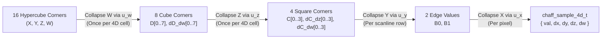

# 4D Analytical Spatiotemporal Noise & Wind-Coupled Volumetric Clouds

**Document Type**: Canonical Architecture Specification  
**Status**: Authoritative Reference  
**Scope**: `libchaff` (`external/libchaff`), NeverDark Seven 3D WebGL2 Renderer (`mods/nd/ux/nd_seven_gl.h`, `mods/nd/ux/nd_seven_gl.c`, `mods/nd/ux/nd_seven.c`)  
**Related Specifications**: [`docs/MULTI_SCALE_NOISE_AND_GPU_ARCHITECTURE.md`](MULTI_SCALE_NOISE_AND_GPU_ARCHITECTURE.md), [`docs/RECUR_NOISE.md`](RECUR_NOISE.md), [`docs/25D.md`](25D.md), [`docs/WATER_REQUIREMENTS.md`](WATER_REQUIREMENTS.md)

---

## 1. Executive Summary & Architectural Goals

This document specifies the mathematical and systems architecture for **4D analytical spatiotemporal noise** in `libchaff` (`<ttypt/noise.h>`, `<ttypt/chaff.h>`, `<ttypt/chaff_glsl.h>`) and its integration into NeverDark Seven's **wind-coupled 4D volumetric cloud, ground/water cloud shadow, and water cloud reflection pipeline** (`mods/nd/ux/nd_seven_gl.c`).

### Core Architectural Invariants
1. **Pure-Integer C99 Determinism in `libchaff`**:
   `chaff_sample_4d`, `chaff_sample_grad_4d`, `chaff_fill_slice_4d`, and `dim == 4` support in `chaff_fill` / `chaff_fill_lod` operate strictly in pure integer arithmetic (`int16_t` modular coordinates, `int64_t` multiply-then-shift fixed-point accumulators, zero floating-point instructions).
2. **Dimensional Reduction for Bulk 2D Slice Stepping (`16 -> 8 -> 4`)**:
   Evaluating a 4D hypercube $(X, Y, Z, W)$ naively at every pixel requires 16 corner hashes and 15 linear interpolations (7 across $W$, 4 across $Z$, 2 across $Y$, 1 across $X$). In `chaff_fill_slice_4d`, when stepping across a 2D horizontal $(X, Y)$ slice at fixed altitude $z$ and time $w$, the $W$ axis ($16 \to 8$) and $Z$ axis ($8 \to 4$) are pre-collapsed **once per 4D cell boundary**, reducing the inner pixel loop to a 4-corner 2D bilinear evaluation that is **100% bit-exact** with point-by-point `chaff_sample_grad_4d`.
3. **Bit-Exact 8-Byte `XXH32` 4D Lattice Hashing Across CPU & WebGL2**:
   A 4D coordinate vector `int16_t p[4] = { x, y, z, w }` occupies exactly 8 bytes, executing two 32-bit `XXH32_round` lanes (`v1 = (y & 0xFFFF) | (x << 16)` and `v2 = (z & 0xFFFF) | (w << 16)`) before the final `XXH32` avalanche. Both `<ttypt/chaff_glsl.h>` (`chaff_hash4`) and `mods/nd/ux/nd_seven_gl.c` replicate this exact 8-byte `XXH32` pipeline in GLSL ES 3.0.
4. **Unified Wind-Coupled Atmospheric Dynamics**:
   Planetary clouds in `nd_seven_gl.c` are driven by the exact same multi-octave moving recursive wind field (`eval_recursive_wind`) that drives ocean gravity waves and capillary cat's-paws, extended with **geostrophic altitude wind-shear** and **4D internal convective boiling** along the $W$ axis.

---

## 2. 4D Hypercube Dimensional Reduction & Analytical Derivatives (`libchaff`)

### 2.1 4D Lattice Coordinate Decomposition

For a 4D coordinate vector $\mathbf{p} = (x, y, z, w) \in \mathbb{Z}_2^{16}$ at octave scale $2^s$ (`shift = s`), each coordinate decomposes into a lattice cell origin and a fractional offset:

$$i_k = p_k \ \& \ \sim(2^s - 1), \qquad f_k = p_k \ \& \ (2^s - 1), \qquad t_k = \frac{f_k \ll 16}{2^s} \in [0, 65536]$$

All cell corner advancements use `int16_t` modular addition `(int16_t)((uint16_t)i_k + (uint16_t)step_px)`, preserving seamless cyclic wrap across the `32767 -> -32768` boundary.

### 2.2 Cubic & Quintic Hermite Fade & Analytical Derivative Polynomials

In Q16 fixed-point ($t \in [0, 65536]$):
- **Cubic Hermite ($C^1$, `NOISE_FADE3`)**:
  $$u_3(t) = t^2(3 - 2t), \qquad u_3'(t) = 6t(1 - t)$$
- **Quintic Hermite ($C^2$, `NOISE_FADE5`)**:
  $$u_5(t) = t^3(6t^2 - 15t + 10), \qquad u_5'(t) = 30t^2(t - 1)^2$$

### 2.3 Hierarchical 4D Hypercube Collapse ($16 \to 8 \to 4 \to 2 \to 1$)

Let $V_{a,b,c,d} \in [0, 255]$ denote the 16 corner hashes of the 4D hypercube at $(i_x + a\Delta, i_y + b\Delta, i_z + c\Delta, i_w + d\Delta)$ for $a,b,c,d \in \{0, 1\}$, scaled to Q16 (`<< 16`):

1. **Collapse $W$ ($16 \to 8$ corners)**:
   For each 3D cube index $m = a + 2b + 4c \in \{0 \dots 7\}$:
   $$D_m = V_{a,b,c,0} + \bigl((V_{a,b,c,1} - V_{a,b,c,0}) \cdot u_w \gg 16\bigr), \qquad \Delta_w D_m = V_{a,b,c,1} - V_{a,b,c,0}$$

2. **Collapse $Z$ ($8 \to 4$ corners)**:
   For each 2D square index $n = a + 2b \in \{0 \dots 3\}$:
   $$C_n = D_n + \bigl((D_{n+4} - D_n) \cdot u_z \gg 16\bigr), \qquad \Delta_z C_n = D_{n+4} - D_n$$
   $$\Delta_w C_n = \Delta_w D_n + \bigl((\Delta_w D_{n+4} - \Delta_w D_n) \cdot u_z \gg 16\bigr)$$

3. **Collapse $Y$ ($4 \to 2$ corners) and $X$ ($2 \to 1$ value)**:
   $$B_0 = C_0 + \bigl((C_2 - C_0) \cdot u_y \gg 16\bigr), \qquad B_1 = C_1 + \bigl((C_3 - C_1) \cdot u_y \gg 16\bigr)$$
   $$F(x,y,z,w) = B_0 + \bigl((B_1 - B_0) \cdot u_x \gg 16\bigr)$$

4. **Analytical 4D Partial Derivatives (`dx`, `dy`, `dz`, `dw`)**:
   $$\frac{\partial F}{\partial x} = \frac{((B_1 - B_0) \cdot u_x' \gg 16)}{2^s}, \qquad \frac{\partial F}{\partial y} = \frac{(\Delta_y(u_x) \cdot u_y' \gg 16)}{2^s}$$
   $$\frac{\partial F}{\partial z} = \frac{(\Delta_z(u_x, u_y) \cdot u_z' \gg 16)}{2^s}, \qquad \frac{\partial F}{\partial w} = \frac{(\Delta_w(u_x, u_y, u_z) \cdot u_w' \gg 16)}{2^s}$$

### 2.4 Public C & GLSL API Summary

| Header | Symbol | Purpose |
| :--- | :--- | :--- |
| `<ttypt/noise.h>` | `noise_sample_4d(pos, shift, seed, flags)` | Scalar 4D noise evaluation at `int16_t pos[4]` |
| `<ttypt/noise.h>` | `chaff_sample_4d(field, pos)` | Multi-octave 4D recursive field evaluation |
| `<ttypt/chaff.h>` | `chaff_sample_4d_t` | Struct `{ int16_t val, dx, dy, dz, dw }` (Q8.8 derivatives) |
| `<ttypt/chaff.h>` | `chaff_sample_grad_4d(pos, shift, seed, flags)` | Single-pass 4D value + analytical 4D partial derivatives |
| `<ttypt/chaff.h>` | `chaff_fill_slice_4d(...)` | Bulk 2D horizontal slice stepper at fixed `(z, w)` with $16 \to 8 \to 4$ pre-collapse |
| `<ttypt/chaff_glsl.h>` | `chaff_hash4(ivec4 p, uint seed)` | Bit-exact 8-byte `XXH32` 4D lattice corner hash in GLSL ES 3.0 |
| `<ttypt/chaff_glsl.h>` | `chaff_sample_4d` / `chaff_sample_grad_4d` | GLSL ES 3.0 4D noise and `vec4` analytical spatial+temporal gradient |

---

### 3. Observer-Gated ("Quantum") 8-Octave 4D Fractal Cloud Architecture in NeverDark Seven

### 3.1 Two-Stage 8-Octave 4D Spatiotemporal Cascade & Synoptic Clear-Sky Gating

In `mods/nd/ux/nd_seven_gl.c`, `eval_zoom_cloud_density(vec3 worldPos, float anim_time, float humidity, float dist, float fw)` (and its pure-C counterpart `nd_seven_gl_eval_zoom_cloud_density`) evaluates an **8-octave rotated and domain-warped 4D fractal cascade** spanning planetary synoptic weather systems down to close-up turbulent wisps (`0.000018 .. 0.096000` cycles/world-unit). Following the exact observer-distance and Nyquist gating paradigm of `eval_zoom_terrain_detail` and `eval_zoom_water_waves`, each octave $i \in \{0 \dots 7\}$ is gated by:

$$w_i = w_{\text{dist},i}(\text{dist}) \cdot w_{\text{nyq},i}(f_i \cdot \text{fw})$$

- **Stage 1 — Planetary Synoptic Fronts & Big Mesoscale Cloud Masses (Octaves 0–3)**:
  - **Octave 0 (`0.000018`, $\lambda \approx 55{,}500$, $d_{\text{far}} = 12\text{M}$)** & **Octave 1 (`0.000075`, $\lambda \approx 13{,}300$, $d_{\text{far}} = 4.5\text{M}$)**: Form planetary-scale synoptic weather fronts (`synFront = mix(oct[0], oct[1], 0.56)`), carving wide crystal-clear high-pressure corridors alongside cyclone/frontal cloud belts visible from planetary orbit.
  - **Octave 2 (`0.000280`, $\lambda \approx 3{,}570$, $d_{\text{far}} = 950\text{k}$)** & **Octave 3 (`0.000950`, $\lambda \approx 1{,}050$, $d_{\text{far}} = 180\text{k}$)**: Rotated by `mat2(0.8, -0.6, 0.6, 0.8)` and domain-warped (`warpSpan = {4200, 1100, 280, 75}`) with billow ridge folding (`1.0 - abs(2.0 * n - 1.0)`) to build large regional cloud decks and towering cumulus clusters (`bigCloud`).
  - **Clear-Sky Early-Out Gate**:
    $$\text{macroMargin} = \text{bigCloud} - \text{clamp}\bigl(0.53 - 0.16 \cdot H_{\text{bio}} + 0.42(0.50 - \text{synFront}), \; 0.36, \; 0.68\bigr)$$
    Whenever $\text{macroMargin} < -0.095$ (~60% of the planet), `eval_zoom_cloud_density` returns `0.0` immediately—skipping `eval_recursive_wind` and all four fine octaves completely in clear sky.
  - **Dynamic Core-Driven Cloud Tops ($z \in [88, 176]$)**:
    Strong cloud cores tower up to $z_{\text{top}} = \text{mix}(118.0, 174.0, \text{coreStrength})$ while thin perimeter fringes stay low ($z \approx 118$), giving big clouds genuine 3D anvil/cumulus vertical relief in a single unified pass.

- **Stage 2 — Wind-Sheared Fine Billow & Cauliflower Detail (Octaves 4–7)**:
  - Evaluated **only inside or near a macro cloud** ($\text{macroMargin} \ge -0.095$) and **only when the observer is within $d_{\text{far},4} = 36{,}000$**:
    - **Octave 4 (`0.003100`, $\lambda \approx 322$, $d_{\text{far}} = 36\text{k}$)**: Individual cumulus towers.
    - **Octave 5 (`0.009800`, $\lambda \approx 102$, $d_{\text{far}} = 8.5\text{k}$)**: Cauliflower turrets.
    - **Octave 6 (`0.031000`, $\lambda \approx 32$, $d_{\text{far}} = 2.4\text{k}$)**: Perimeter billow curls.
    - **Octave 7 (`0.096000`, $\lambda \approx 10$, $d_{\text{far}} = 980$)**: Close-up turbulent filaments and shadow wisps.
  - Coupled to `eval_recursive_wind(worldPos.xy, anim_time)` with geostrophic altitude wind-shear and 4D convective boiling (`wBoil = mod(anim_time * 0.072, 512.0)`).

### 3.2 Below, Inside, and Above the Clouds: Four-Shader Integration

1. **Below the Clouds (`uCamDist < 880.0`) — Overhead Sky Shell Skipped, Full Shadows on Lamb, Ground & Water**:
   - When the camera is close to the ground looking at the lamb (`s_gl.cur_dist < 880.0f`), `nd_seven_gl_flush_clouds` skips drawing the overhead cloud shell completely (zero volumetric overdraw).
   - Instead, overhead clouds manifest on the ground, water, and the lamb itself:
     - **Lamb & Sprite Billboards (`s_fs_billboard`)**: Projects `vLocalPos` along the sun vector to $z = 108$ and modulates direct solar diffuse and rim lighting by `cloudShadow = exp(-2.15 * eval_zoom_cloud_density(..., camDist, 0.35))` so passing fractal clouds cast moving shadows directly over the lamb.
     - **Terrain (`s_fs_terrain`)**: `eval_planetary_cloud_shadow` projects terrain fragments along $\mathbf{L}_{\text{sun}} = \text{normalize}(-0.577, -0.577, 0.816)$ to $z = 108$ (plus upper $z = 138$ when close), modulating direct solar diffuse and specular glints with full observer-gated fractal shadow edges.
     - **Water (`s_fs_water`)**: Modulates solar glitter (`specSun`) and wave slope hillshading by `sunTrans`, and traces the wave-perturbed reflection ray `waveRefl = reflect(-viewDir, waveNormal)` to $z = 110$ so sunlit billowing clouds reflect realistically in the water around the lamb.
2. **Climbing Through & Above the Clouds (`uCamDist >= 880.0`) — Single-Pass Volumetric Shell**:
   - As the camera climbs into and above the cloud layer (`shellFade = smoothstep(880.0, 1380.0, uCamDist)`), a single unified curved-torus shell (`effWz = 114.0`) fades in smoothly with radial focal aperture parting (`apertureMask`) around the center of view.
   - Uses observer-adaptive volumetric ray-slab integration (`2` steps when `vDistance > 8500.0`, `3` steps at `z = {98, 114, 142}` when closer, with immediate `break` if the lower slabs are clear sky) and Henyey-Greenstein + Beer-Powder silver-lining scattering:
     $$E_{\text{light}}(\tau_{\odot}) = \text{mix}\!\left(e^{-\tau_{\odot}}, \; e^{-\tau_{\odot}}\bigl(0.42 + 0.98(1 - e^{-2.35\tau_{\odot}})\bigr), \; 0.68\right) \cdot \Phi_{\text{HG}}(\cos\theta)$$

---

## 4. Verification & Quality Gates

- **`external/libchaff/tests/test_chaff.c`**:
  - Test 14: Verifies `chaff_sample_grad_4d` value parity with `noise_sample_4d` and analytical gradient sign/bounds across all 4 axes (`dx`, `dy`, `dz`, `dw`) under both `NOISE_FADE3` and `NOISE_FADE5`.
  - Test 15: Verifies 100% bit-exact parity between `chaff_fill_slice_4d` and point-by-point `chaff_sample_grad_4d` across multi-cell boundaries and `int16_t` modular wrap limits (`32760 -> -32768`), plus `dim == 4` `chaff_fill` / `chaff_fill_lod` parity.
  - Test 16: Verifies 100% bit-exact parity between `chaff_glsl_ref_hash4` and `noise_r(va, seed, 0, 4)`, plus `chaff_glsl_ref_sample_grad_4d` analytical derivative accuracy against central finite differences.
- **`tests/unit/test_seven_render.c`**:
  - Validates all 4 WebGL2 shader programs (`terrain`, `water`, `billboard`, `cloud`) with `glslangValidator -l` (GLSL ES 3.00).
  - Verifies `nd_seven_gl_eval_zoom_cloud_density` and `nd_seven_gl_eval_cloud_density` determinism, planetary clear-sky vs. cloudy weather distribution, towering cloud core vs. crown vertical profiles (`[88..176]`), observer-distance progressive octave gradient activation (`close > mid > far`), climate humidity sensitivity (`humid > arid * 1.25`), and 4D temporal derivative stability at $t = 100{,}000\text{ s}$ vs $t = 10\text{ s}$.

