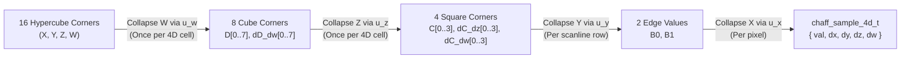

# 4D Analytical Spatiotemporal Noise & Wind-Coupled Volumetric Clouds

**Document Type**: Canonical Architecture Specification  
**Status**: Authoritative Reference  
**Scope**: `libchaff` (`external/libchaff`), NeverDark Seven 3D WebGL2 Renderer (`mods/nd/ux/nd_seven_gl.h`, `mods/nd/ux/nd_seven_gl.c`, `mods/nd/ux/nd_seven.c`)  
**Related Specifications**: [`docs/MULTI_SCALE_NOISE_AND_GPU_ARCHITECTURE.md`](MULTI_SCALE_NOISE_AND_GPU_ARCHITECTURE.md), [`docs/RECUR_NOISE.md`](RECUR_NOISE.md), [`docs/25D.md`](25D.md), [`docs/WATER_REQUIREMENTS.md`](WATER_REQUIREMENTS.md)

---

## 1. Executive Summary & Architectural Goals

This document specifies the mathematical and systems architecture for **4D analytical spatiotemporal noise** in `libchaff` (`<ttypt/noise.h>`, `<ttypt/chaff.h>`, `<ttypt/chaff_glsl.h>`) and its integration into NeverDark Seven's **wind-coupled 4D volumetric cloud, ground/water cloud shadow, and water cloud reflection pipeline** (`mods/nd/ux/nd_seven_gl.c`).

### Core Architectural Invariants
1. **Pure-Integer C99 Determinism in `libchaff`**:
   `chaff_sample_4d`, `chaff_sample_grad_4d`, `chaff_fill_slice_4d`, and `dim == 4` support in `chaff_fill` / `chaff_fill_lod` operate strictly in pure integer arithmetic (`int16_t` modular coordinates, `int64_t` multiply-then-shift fixed-point accumulators, zero floating-point instructions).
2. **Dimensional Reduction for Bulk 2D Slice Stepping (`16 -> 8 -> 4`)**:
   Evaluating a 4D hypercube $(X, Y, Z, W)$ naively at every pixel requires 16 corner hashes and 15 linear interpolations (7 across $W$, 4 across $Z$, 2 across $Y$, 1 across $X$). In `chaff_fill_slice_4d`, when stepping across a 2D horizontal $(X, Y)$ slice at fixed altitude $z$ and time $w$, the $W$ axis ($16 \to 8$) and $Z$ axis ($8 \to 4$) are pre-collapsed **once per 4D cell boundary**, reducing the inner pixel loop to a 4-corner 2D bilinear evaluation that is **100% bit-exact** with point-by-point `chaff_sample_grad_4d`.
3. **Bit-Exact 8-Byte `XXH32` 4D Lattice Hashing Across CPU & WebGL2**:
   A 4D coordinate vector `int16_t p[4] = { x, y, z, w }` occupies exactly 8 bytes, executing two 32-bit `XXH32_round` lanes (`v1 = (y & 0xFFFF) | (x << 16)` and `v2 = (z & 0xFFFF) | (w << 16)`) before the final `XXH32` avalanche. Both `<ttypt/chaff_glsl.h>` (`chaff_hash4`) and `mods/nd/ux/nd_seven_gl.c` replicate this exact 8-byte `XXH32` pipeline in GLSL ES 3.0.
4. **Unified Wind-Coupled Atmospheric Dynamics**:
   Planetary clouds in `nd_seven_gl.c` are driven by the exact same multi-octave moving recursive wind field (`eval_recursive_wind`) that drives ocean gravity waves and capillary cat's-paws, extended with **geostrophic altitude wind-shear** and **4D internal convective boiling** along the $W$ axis.

---

## 2. 4D Hypercube Dimensional Reduction & Analytical Derivatives (`libchaff`)

### 2.1 4D Lattice Coordinate Decomposition

For a 4D coordinate vector $\mathbf{p} = (x, y, z, w) \in \mathbb{Z}_2^{16}$ at octave scale $2^s$ (`shift = s`), each coordinate decomposes into a lattice cell origin and a fractional offset:

$$i_k = p_k \ \& \ \sim(2^s - 1), \qquad f_k = p_k \ \& \ (2^s - 1), \qquad t_k = \frac{f_k \ll 16}{2^s} \in [0, 65536]$$

All cell corner advancements use `int16_t` modular addition `(int16_t)((uint16_t)i_k + (uint16_t)step_px)`, preserving seamless cyclic wrap across the `32767 -> -32768` boundary.

### 2.2 Cubic & Quintic Hermite Fade & Analytical Derivative Polynomials

In Q16 fixed-point ($t \in [0, 65536]$):
- **Cubic Hermite ($C^1$, `NOISE_FADE3`)**:
  $$u_3(t) = t^2(3 - 2t), \qquad u_3'(t) = 6t(1 - t)$$
- **Quintic Hermite ($C^2$, `NOISE_FADE5`)**:
  $$u_5(t) = t^3(6t^2 - 15t + 10), \qquad u_5'(t) = 30t^2(t - 1)^2$$

### 2.3 Hierarchical 4D Hypercube Collapse ($16 \to 8 \to 4 \to 2 \to 1$)

Let $V_{a,b,c,d} \in [0, 255]$ denote the 16 corner hashes of the 4D hypercube at $(i_x + a\Delta, i_y + b\Delta, i_z + c\Delta, i_w + d\Delta)$ for $a,b,c,d \in \{0, 1\}$, scaled to Q16 (`<< 16`):

1. **Collapse $W$ ($16 \to 8$ corners)**:
   For each 3D cube index $m = a + 2b + 4c \in \{0 \dots 7\}$:
   $$D_m = V_{a,b,c,0} + \bigl((V_{a,b,c,1} - V_{a,b,c,0}) \cdot u_w \gg 16\bigr), \qquad \Delta_w D_m = V_{a,b,c,1} - V_{a,b,c,0}$$

2. **Collapse $Z$ ($8 \to 4$ corners)**:
   For each 2D square index $n = a + 2b \in \{0 \dots 3\}$:
   $$C_n = D_n + \bigl((D_{n+4} - D_n) \cdot u_z \gg 16\bigr), \qquad \Delta_z C_n = D_{n+4} - D_n$$
   $$\Delta_w C_n = \Delta_w D_n + \bigl((\Delta_w D_{n+4} - \Delta_w D_n) \cdot u_z \gg 16\bigr)$$

3. **Collapse $Y$ ($4 \to 2$ corners) and $X$ ($2 \to 1$ value)**:
   $$B_0 = C_0 + \bigl((C_2 - C_0) \cdot u_y \gg 16\bigr), \qquad B_1 = C_1 + \bigl((C_3 - C_1) \cdot u_y \gg 16\bigr)$$
   $$F(x,y,z,w) = B_0 + \bigl((B_1 - B_0) \cdot u_x \gg 16\bigr)$$

4. **Analytical 4D Partial Derivatives (`dx`, `dy`, `dz`, `dw`)**:
   $$\frac{\partial F}{\partial x} = \frac{((B_1 - B_0) \cdot u_x' \gg 16)}{2^s}, \qquad \frac{\partial F}{\partial y} = \frac{(\Delta_y(u_x) \cdot u_y' \gg 16)}{2^s}$$
   $$\frac{\partial F}{\partial z} = \frac{(\Delta_z(u_x, u_y) \cdot u_z' \gg 16)}{2^s}, \qquad \frac{\partial F}{\partial w} = \frac{(\Delta_w(u_x, u_y, u_z) \cdot u_w' \gg 16)}{2^s}$$

### 2.4 Public C & GLSL API Summary

| Header | Symbol | Purpose |
| :--- | :--- | :--- |
| `<ttypt/noise.h>` | `noise_sample_4d(pos, shift, seed, flags)` | Scalar 4D noise evaluation at `int16_t pos[4]` |
| `<ttypt/noise.h>` | `chaff_sample_4d(field, pos)` | Multi-octave 4D recursive field evaluation |
| `<ttypt/chaff.h>` | `chaff_sample_4d_t` | Struct `{ int16_t val, dx, dy, dz, dw }` (Q8.8 derivatives) |
| `<ttypt/chaff.h>` | `chaff_sample_grad_4d(pos, shift, seed, flags)` | Single-pass 4D value + analytical 4D partial derivatives |
| `<ttypt/chaff.h>` | `chaff_fill_slice_4d(...)` | Bulk 2D horizontal slice stepper at fixed `(z, w)` with $16 \to 8 \to 4$ pre-collapse |
| `<ttypt/chaff_glsl.h>` | `chaff_hash4(ivec4 p, uint seed)` | Bit-exact 8-byte `XXH32` 4D lattice corner hash in GLSL ES 3.0 |
| `<ttypt/chaff_glsl.h>` | `chaff_sample_4d` / `chaff_sample_grad_4d` | GLSL ES 3.0 4D noise and `vec4` analytical spatial+temporal gradient |

---

### 3. Observer-Gated ("Quantum") 8-Octave 4D Volumetric Cloud Architecture in NeverDark Seven

### 3.1 True 4D Isotropic Unit-Gradient Dot-Product Noise (`chaff_grad4`)

Scalar value noise in 4D exhibits axis-aligned hypercubic grid artifacts when domain-warped or thresholded at high contrast. To guarantee 100% smooth, isotropic cloud contours with zero lattice boxiness or pixelation at any zoom level, `nd_seven_gl.c` (`s_fs_terrain`, `s_fs_water`, `s_fs_billboard`, `s_vs_cloud`, `s_fs_cloud`, and CPU reference `gl_chaff_grad_noise4d`) unpacks 4D unit gradient vectors from the 32-bit `chaff_hash4` avalanche at all 16 hypercube corners:

$$\mathbf{g}(\mathbf{c}) = \text{normalize}\!\left(\text{float}\bigl((h \gg \{0,8,16,24\}) \ \& \ \text{0xFF}\bigr) - 128.0\right)$$

and interpolates the 16 directional dot products $v_k = \mathbf{g}_k \cdot (\mathbf{f}_p - \mathbf{o}_k)$ using quintic $C^2$ Hermite fade polynomials $u(t) = t^3(6t^2 - 15t + 10)$. Furthermore, both `s_fs_water` and `s_fs_cloud` sample `uSubstrateTex` through a shared quintic $C^2$ sub-texel filter (`sampleSubstrateSmooth(vUV)`), and `nd_seven_gl_flush_clouds` selects adaptive mesh subdivision (`select_grid_buffers(chk->level, ...)`) per chunk so neither substrate humidity nor cloud geometry ever exhibits bilinear texel or polygon faceting.

### 3.2 Continent-to-Cumulus 8-Octave Cascade & Smooth $C^\infty$ *Nubis* Billow Erosion

`eval_zoom_cloud_density(vec3 worldPos, float anim_time, float humidity, float dist, float fw)` (and its pure-C counterpart `nd_seven_gl_eval_zoom_cloud_density`) evaluates a **continuous $4.8\times$ geometric 8-octave 4D cascade** across the vertical altitude slab $z \in [92.0, 232.0]$:

| Octave | Frequency (`freqs[i]`) | Wavelength ($\lambda_i = 1 / f_i$) | Rooms ($\lambda_i / 160$) | $d_{\text{near}} \to d_{\text{far}}$ | Physical Meteorological Scale |
| :---: | :---: | :---: | :---: | :---: | :--- |
| **0** | `0.00000050` | $2{,}000{,}000$ units | $12{,}500$ rooms | $8\text{M} \to 24\text{M}$ | Planetary ITCZ / extratropical cyclone belts |
| **1** | `0.00000240` | $416{,}667$ units | $2{,}604$ rooms | $1.8\text{M} \to 6\text{M}$ | Continent-scale baroclinic frontal waves & comma heads |
| **2** | `0.00001150` | $86{,}957$ units | $543$ rooms | $220\text{k} \to 950\text{k}$ | Sub-continental synoptic cloud shields & dry slots |
| **3** | `0.00005500` | $18{,}182$ units | $114$ rooms | $45\text{k} \to 220\text{k}$ | Regional mesoscale cloud streets & squall bands |
| **4** | `0.00026000` | $3{,}846$ units | $24$ rooms | $9.6\text{k} \to 48\text{k}$ | Multi-room cumulus congestus complexes |
| **5** | `0.00125000` | $800$ units | $5.0$ rooms | $2.2\text{k} \to 10\text{k}$ | Individual cumulus towers ($5$-room scale) |
| **6** | `0.00600000` | $166.7$ units | $1.04$ rooms | $520 \to 2.4\text{k}$ | Single-room cumulus domes |
| **7** | `0.02800000` | $35.7$ units | $0.22$ rooms | $180 \to 750$ | Soft local cloud-edge puffs (Nyquist-clamped at $\ge 35.7$ units) |

- **Stage 1 — Divergence-Free Planetary Geostrophic Cyclone Streamfunction & Synoptic Coverage (Octaves 0–3)**:
  - A 2-octave planetary geostrophic streamfunction $\Psi_0(\mathbf{x}, t), \Psi_1(\mathbf{x}, t)$ ($\lambda_{\Psi_0} \approx 2.38 \times 10^6$, $\lambda_{\Psi_1} \approx 5.56 \times 10^5$) warps the macro coordinates via the divergence-free skew gradient $\mathbf{v}_{\text{syn}} = (-\partial_y \Psi, \partial_x \Psi)$ (`synWarp0` up to $260{,}000$ units, `mesoWarp` up to $14{,}000$ units). This curls planetary cloud bands into long, sweeping comma-cloud fronts and cyclonic spirals without introducing high-frequency cell-space phase scrambling.
  - Every macro octave $i \in \{0\dots 3\}$ is weighted by both observer distance and screen-space Nyquist footprint (`wMacro[i] = wDist * wNyq`, with floor $0.25$ on Octaves 0–1 at extreme orbital distances) and combined into a single smooth, non-multiplicative synoptic field:
    $$\text{contFront} = 0.50 + 0.58\,w_0(\text{oct}_0 - 0.50) + 0.46\,w_1(\text{oct}_1 - 0.50)$$
    $$\text{regBand} = 0.50 + 0.52\,w_2(\text{oct}_2 - 0.50) + 0.42\,w_3(\text{oct}_3 - 0.50)$$
    $$\text{synFront} = \text{mix}(\text{contFront}, \text{regBand}, 0.48\,w_2) + 0.28\,\text{orbitBoost}\,(\text{contFront} - 0.50)$$
    $$\text{macroCoverage} = \text{smoothstep}(0.515 - 0.115 H, \; 0.695 - 0.065 H, \; \text{synFront})$$
    Because `oct[2]` and `oct[3]` modulate `contFront` additively rather than chopping it via a multiplicative gate, continent-scale weather fronts remain unbroken over millions of world units while preserving ~60–65% crystal-clear sky corridors (`macroCoverage <= 0.015`).
  - **3D Vertical Cumulus & Anvil Envelope ($z \in [92, 232]$)**:
    Strong cloud cores tower up to $z_{\text{top}} = \text{mix}(132.0, 232.0, \text{coreStrength})$ while thin perimeter fringes stay low ($z \approx 132$), shaped by rounded base/crown vertical profiles $v_{\text{prof}}(h_{\text{local}}) = \text{smoothstep}(0.0, 0.15, h_{\text{local}}) \cdot \text{smoothstep}(1.0, 0.42, h_{\text{local}})$ and mapped into the base cloud envelope via `cloud_remap`:
    $$\text{baseCloud} = \text{clamp}\!\left(\text{cloud\_remap}\bigl(\text{macroCoverage} \cdot v_{\text{prof}}, \; 0.12(1 - 0.45\,\text{coreStrength}), \; 0.86, \; 0.0, \; 1.0\bigr), \; 0.0, \; 1.0\right)$$

- **Stage 2 — Smooth $C^\infty$ Cumulus Lobe Erosion (Octaves 4–7)**:
  - Evaluated **only inside a macro cloud** ($\text{baseCloud} > 0.002$) and **only when the observer is within $d_{\text{far},4} = 240{,}000$**, coupled to `eval_recursive_wind(worldPos.xy, anim_time)` with world-space displacement `windDisp` and 4D convective boiling (`wBoil = mod(anim_time * 0.072, 512.0)`).
  - Instead of the non-differentiable $C^0$ crease `1.0 - abs(2.0 * n - 1.0)` (whose derivative jumps from $+2$ to $-2$ at $n = 0.5$, doubling spatial frequencies), each active fine octave evaluates a **hyperbolically smoothed $C^\infty$ cumulus lobe**:
    $$d = n - 0.5, \qquad \text{cauliflower}(n) = \text{clamp}\!\left(0.52 + 0.45\,d + 0.75\bigl(0.22 - \sqrt{d^2 + 0.018}\bigr), \; 0.0, \; 1.0\right)$$
    with continuous analytical derivative $\frac{\partial\,\text{cauliflower}}{\partial n} = 0.45 - \frac{0.75\,d}{\sqrt{d^2 + 0.018}}$.
  - The normalized billow FBM gently carves the outer shell of `baseCloud` (`erodeAmt = normErode * 0.34 * (1.0 - 0.62 * coreStrength) * (0.30 + 0.70 * hLocal)`), producing soft, rounded cumulus domes with zero high-frequency grain.

### 3.3 Scale-Adaptive 3D Torus Shell Relief & Curvature-Invariant Shell-Centered Raymarching

1. **Scale-Adaptive 3D Torus Vertex Shell (`s_vs_cloud` & `uCloudDeck`)**:
   - In `nd_seven_gl_flush_clouds`, the cloud shell base and vertical span scale smoothly with camera altitude via `alt_scale = smoothstep(1800.0, 280000.0, cur_dist)`:
     $$\text{deck\_base} = 92.0 + 1350.0 \cdot \text{alt\_scale}, \qquad \text{deck\_span} = 160.0 + 24000.0 \cdot \text{alt\_scale}$$
     passed to `uCloudDeck = vec4(deck_base, deck_span, cur_dist, alt_scale)`.
   - `s_vs_cloud` evaluates the continent-to-mesoscale macro dome (`eval_vertex_cloud_dome(worldXY, uAnimTime, uCamDist)`) per vertex, displaces the curved torus cloud mesh along the outward surface normal by `effWz = deck_base + deck_span * (0.08 + 0.78 * macroDome)`, and passes the normalized canonical shell height `vShellZ = 92.0 + 140.0 * (0.08 + 0.78 * macroDome)` to `s_fs_cloud`. At orbital zoom, continent-scale weather systems therefore exhibit up to $\sim 20{,}000$ world units of true 3D geometric relief over the curved planet torus.
2. **Torus Curvature Sagitta Compensation & Shell-Centered Raymarching (`s_fs_cloud`)**:
   - On a curved planet torus of minor radius $r_0 \approx 6.11 \times 10^6$, the chord vector `vViewDir = uCameraPos - worldPos` drops below the local tangent plane by the torus sagitta $\Delta z_{\text{curv}} \approx D_{\text{horiz}}^2 / (2 r_0)$. Without compensation, `vShellZ + dot(vViewDir, torusN)` becomes negative for any fragment further than $\sim 28{,}700$ units from the sub-camera point, falsely triggering below-cloud `discard` outside a flat central disk.
   - `s_fs_cloud` restores the curvature sagitta:
     $$\text{curvSagitta} = \frac{\max(0.0, \; d_{\text{frag}}^2 - v_n^2)}{2 r_0}, \qquad \text{camAlt} = \max\bigl(\text{vShellZ} + v_n + \text{curvSagitta}, \; u_{\text{CamDist}} \cdot 0.85\bigr)$$
     and restricts the below-cloud breakout discard strictly to low-altitude local views (`uCamDist < 360.0 && camAlt < zBase && dz <= 0.0`).
   - Rather than tracing from `t = 0` at the camera and truncating grazing rays inside empty upper air (`[175, 232]`), the raymarch interval `[tEnter, tExit]` is parameterized **symmetrically around the curved shell intersection `s = 0` (`vShellH`)** using a grazing-clamped effective vertical slope `effDz = (abs(dz) > 0.35) ? dz : ((dz >= 0.0) ? 0.35 : -0.35)`:
     $$t_{\text{enter}} = \max(-d_{\text{frag}} \cdot 0.95, \; \min(s_{\text{base}}, s_{\text{top}})), \qquad t_{\text{exit}} = \max(s_{\text{base}}, s_{\text{top}})$$
     Every ray across the entire visible torus — from nadir to the curved planetary limb — therefore sweeps full-depth through $h_{\text{frac}} \in [0.02, 0.98]$ of the cloud deck `[92.0, 232.0]`.
3. **Deterministic 6-to-8 Step 3D Raymarch & Scale-Proportional Solar Self-Shadowing**:
   - Marches `numSteps` (`6` when `vDistance > 24000`, `7` when `vDistance > 4500`, `8` when close) deterministic midpoint samples (`t = tEnter + (float(s) + 0.5) * dt`, with zero screen-space `gl_FragCoord` white-noise jitter) along `[tEnter, tExit]`.
   - At each active sample, probes solar optical depth $\tau_{\odot}$ and vertical crown gradient (`dSun1`, `dTop`) at a **scale-proportional horizontal offset** `sunProbeXY = clamp(max(18.0, fw * 3.2), 18.0, 45000.0)` and the **exact same `(stepDist, fw)` filter footprint** as the primary `dens` sample, forming a smooth 3D cloud normal `cloudGradN` across all zoom levels from room-scale cumulus domes to continent-scale cyclone bands:
     $$E_{\text{light}}(\tau_{\odot}) = \Bigl(e^{-\tau_{\odot}}\bigl(0.44 + 0.96(1 - e^{-2.45\tau_{\odot}})\bigr) + 0.22\,e^{-0.35\tau_{\odot}}\Bigr) \cdot \Phi_{\text{HG}}(\cos\theta) \cdot \text{domeLambert}$$
4. **Seamless Cross-LOD Fading (`gpuFieldBlend`) Across Quadtree Boundaries**:
   - Both `s_fs_cloud` and `s_fs_terrain` compute the dual-criteria cross-LOD blend weight:
     $$\text{spanBlend} = \text{smoothstep}(3.3, 13.5, u_{\text{ChunkSpan},x} / 48.0), \qquad \text{distBlend} = \text{smoothstep}(1400.0, 4800.0, d_{\text{cam}}), \qquad \text{gpuFieldBlend} = \text{clamp}(\max(\text{spanBlend}, \text{distBlend}), 0, 1)$$
   - As chunks transition from near-field server/quadtree tiles to coarser LOD rings, `gpuFieldBlend` smoothly cross-fades the per-chunk `uSubstrateTex` biome humidity (`texBioHumidity`) into a continuous chunk-independent world-space climate humidity field (`worldBioHumidity`), and cross-fades the screen-space derivative filter width `rawFw` into a continuous distance-proportional filter width `contFw`. Adjacent quadtree chunks of different LOD levels therefore evaluate identical cloud density, Nyquist octave weights, terrain cloud shadows, and single-pass water cloud reflections at their shared border with **zero LOD boundary seams or popping**.

---

## 4. Verification & Quality Gates

- **`external/libchaff/tests/test_chaff.c`**:
  - Test 14: Verifies `chaff_sample_grad_4d` value parity with `noise_sample_4d` and analytical gradient sign/bounds across all 4 axes (`dx`, `dy`, `dz`, `dw`) under both `NOISE_FADE3` and `NOISE_FADE5`.
  - Test 15: Verifies 100% bit-exact parity between `chaff_fill_slice_4d` and point-by-point `chaff_sample_grad_4d` across multi-cell boundaries and `int16_t` modular wrap limits (`32760 -> -32768`), plus `dim == 4` `chaff_fill` / `chaff_fill_lod` parity.
  - Test 16: Verifies 100% bit-exact parity between `chaff_glsl_ref_hash4` and `noise_r(va, seed, 0, 4)`, plus `chaff_glsl_ref_sample_grad_4d` analytical derivative accuracy against central finite differences.
- **`tests/unit/test_seven_render.c`**:
  - Validates all 4 WebGL2 shader programs (`terrain`, `water`, `billboard`, `cloud`) with `glslangValidator -l` (GLSL ES 3.00).
  - Verifies `chaff_grad4`, `cloud_remap`, `eval_vertex_cloud_dome`, `vShellZ`, `camAlt`, `curvSagitta`, `uCloudDeck`, and `sampleSubstrateSmooth` shader contracts, `nd_seven_gl_eval_zoom_cloud_density` determinism, continent-scale spatial coherence ($\lambda_0 = 2{,}000{,}000$) at orbital zoom, planetary clear-sky vs. cloudy synoptic distribution, towering cloud core vs. crown vertical profiles (`[92..232]`), observer-distance progressive octave gradient activation (`close > mid > far`), climate humidity sensitivity (`humid > arid * 1.25`), and 4D temporal derivative stability at $t = 100{,}000\text{ s}$ vs $t = 10\text{ s}$.

